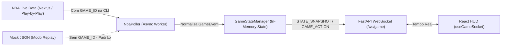

# 🏀 NBA Live HUD

HUD interativo de transmissão esportiva em tempo real para partidas da **NBA**, construído com **FastAPI + WebSockets** no backend e **React + TypeScript + Tailwind CSS v4** no frontend.

O sistema monitora partidas ao vivo diretamente dos dados oficiais da NBA (ou simula jogos via modo Replay offline), mantendo o placar, cronômetro, quintetos em quadra, substituições e alertas visuais de lances sincronizados com baixa latência.

---

## Funcionalidades

- **Placar de Transmissão Ao Vivo (`Scoreboard`):**
  - Exibe sigla, nome da franquia, campanha (`wins-losses`), cores oficiais das 30 equipes da NBA, período (`Q1`–`Q4`, `OT`) e cronômetro formatado a partir do padrão ISO-8601 da NBA (`PT12M00.00S` → `12:00`).
  - Rodapé dinâmico com nome da arena e cidade da partida.
- **Quintetos em Quadra (`OnCourtRoster`):**
  - Lista em tempo real os 5 jogadores em quadra de cada equipe.
  - Destaca automaticamente o jogador envolvido no lance ativo e exibe o selo animado **`ENTROU`** quando ocorre uma substituição.
- **Alertas Animados de Lances (`EventBanner`):**
  - Fila inteligente de eventos com duração controlada (`3.5s` por destaque) para cestas de 3 pontos, cestas de 2 pontos, lances livres convertidos, faltas, tocos, roubos de bola, turnovers e substituições.
  - Filtra automaticamente arremessos errados (`MISS`) para que apenas lances relevantes disparem banners comemorativos.
- **Feed de Últimos Lances:**
  - Histórico instantâneo com os 5 lances mais recentes da partida.
- **Sincronização Instantânea via WebSocket (`STATE_SNAPSHOT` + `GAME_ACTION`):**
  - Novos clientes conectados recebem imediatamente o snapshot consolidado da partida sem aguardar o próximo lance e sem disparar enxurradas de alertas antigos.
  - Reconexão automática com indicador visual (`WS LIVE` / `RECONECTANDO...`).
- **Seleção Dinâmica via Linha de Comando (Modo Ao Vivo & Modo Replay):**
  - Ao passar um `GAME_ID` ao iniciar o backend, o servidor monitora a partida real da NBA em tempo real.
  - Se nenhum `GAME_ID` for informado, o servidor inicia automaticamente no **Modo Replay** usando o arquivo local `backend/mocks/sample_game.json`.

---

## Arquitetura do Projeto



### Estrutura de Pastas

```text
nba_live_hud/
├── backend/
│   ├── app/
│   │   ├── main.py          # CLI, servidor FastAPI, rotas /health e WebSocket /ws/game
│   │   ├── models.py        # Modelos Pydantic (GameEvent e GameSnapshot)
│   │   ├── poller.py        # Worker assíncrono de ingestão ao vivo e modo replay
│   │   └── state.py         # Gerenciador de estado da partida, quintetos e broadcast WS
│   ├── mocks/
│   │   └── sample_game.json # Partida simulada para testes offline
│   └── requirements.txt     # Dependências Python
└── frontend/
    ├── src/
    │   ├── components/      # Componentes do HUD (Scoreboard, EventBanner, OnCourtRoster, etc.)
    │   ├── config/          # Paleta oficial das 30 franquias da NBA e estilos de eventos
    │   ├── hooks/           # Hook useGameSocket (conexão WS, fila de banners e estado)
    │   ├── types/           # Contratos TypeScript espelhados com o backend
    │   ├── utils/           # Parser de cronômetro ISO-8601 e formatação de períodos
    │   ├── App.tsx          # Layout principal do HUD
    │   └── main.tsx         # Ponto de entrada React
    ├── package.json
    ├── tsconfig.json
    └── vite.config.ts
```

---

## Tecnologias Utilizadas

### Backend
- **Python 3.12+**
- **FastAPI** & **Uvicorn** (API assíncrona e servidor ASGI com WebSockets nativos)
- **HTTPX** (Cliente HTTP assíncrono para polling não-bloqueante)
- **Pydantic v2** (Validação e serialização de eventos `GameEvent` e `GameSnapshot`)

### Frontend
- **React 19** + **TypeScript**
- **Vite** (Bundler e servidor de desenvolvimento com HMR)
- **Tailwind CSS v4** (Estilização utilitária, glassmorphism e animações)
- **Lucide React** (Ícones esportivos e indicadores visuais)

---

## Como Executar o Projeto

### Pré-requisitos
- **Python 3.12+**
- **Node.js 20+** e **npm**

---

### 1. Configurando e Rodando o Backend

No terminal, a partir da raiz do projeto:

```powershell
cd backend

# Crie o ambiente virtual (caso ainda não exista)
python -m venv venv

# Instale as dependências
.\venv\Scripts\pip install -r requirements.txt
```

Agora inicie o servidor escolhendo o modo desejado direto pelo terminal (sem precisar editar o código):

#### Opção A — Modo Replay (Padrão, sem parâmetros)
Se você **não passar nenhum parâmetro**, o servidor roda automaticamente a partida simulada de exemplo (`backend/mocks/sample_game.json`):

```powershell
.\venv\Scripts\python -m app.main
```

#### Opção B — Modo Ao Vivo (Passando o `GAME_ID` da partida)
Informe o `GAME_ID` de qualquer partida da NBA (encontrado na URL do jogo em `nba.com/game/...`, ex: `0022600244`):

```powershell
.\venv\Scripts\python -m app.main 0022600244
```
*(Você também pode usar a flag explícita: `.\venv\Scripts\python -m app.main --game-id 0022600244`)*

- **Health Check:** `http://127.0.0.1:8000/health`
- **Endpoint WebSocket:** `ws://127.0.0.1:8000/ws/game`

---

### 2. Configurando e Rodando o Frontend

Em um **segundo terminal**, a partir da raiz do projeto:

```powershell
cd frontend

# Instale as dependências
npm install

# Inicie o servidor de desenvolvimento Vite
npm run dev
```

Acesse no navegador: **`http://localhost:5173`**

---

## Protocolo de Mensagens WebSocket (`/ws/game`)

O servidor envia dois tipos de eventos JSON discriminados pelo campo `event_type`:

### 1. `STATE_SNAPSHOT` (Enviado imediatamente ao conectar)
Sincroniza o estado completo da partida, metadados das equipes, quintetos em quadra e os 5 últimos lances:

```json
{
  "event_type": "STATE_SNAPSHOT",
  "game_id": "0022600243",
  "home_team": "MIL",
  "home_team_name": "Bucks",
  "home_record": "1-12",
  "away_team": "ATL",
  "away_team_name": "Hawks",
  "away_record": "7-6",
  "arena_name": "Fiserv Forum",
  "arena_city": "Milwaukee",
  "score_home": 73,
  "score_away": 80,
  "period": 3,
  "clock": "PT02M30.00S",
  "home_on_court": ["J. Jaquez Jr.", "K. Jakučionis", "G. Trent Jr.", "K. Ware", "N. Ament"],
  "away_on_court": ["C. McCollum", "L. Dort", "Z. Ejiofor", "A. Wiggins", "C. Kispert"],
  "recent_actions": []
}
```

### 2. `GAME_ACTION` (Enviado a cada novo lance da partida)
Atualiza placar, relógio, quintetos em quadra e alimenta a fila de alertas animados e o histórico de últimos lances:

```json
{
  "event_type": "GAME_ACTION",
  "action_number": 3,
  "action_type": "3pt",
  "sub_type": "Jump Shot",
  "team": "BOS",
  "player": "J. Tatum",
  "description": "Tatum 26' 3PT Jump Shot (3 PTS)",
  "score_home": 2,
  "score_away": 3,
  "period": 1,
  "clock": "PT11M20.00S",
  "home_on_court": ["D. Russell", "A. Reaves", "R. Hachimura", "L. James", "A. Davis"],
  "away_on_court": ["J. Holiday", "D. White", "J. Brown", "J. Tatum", "K. Porzingis"]
}
```
